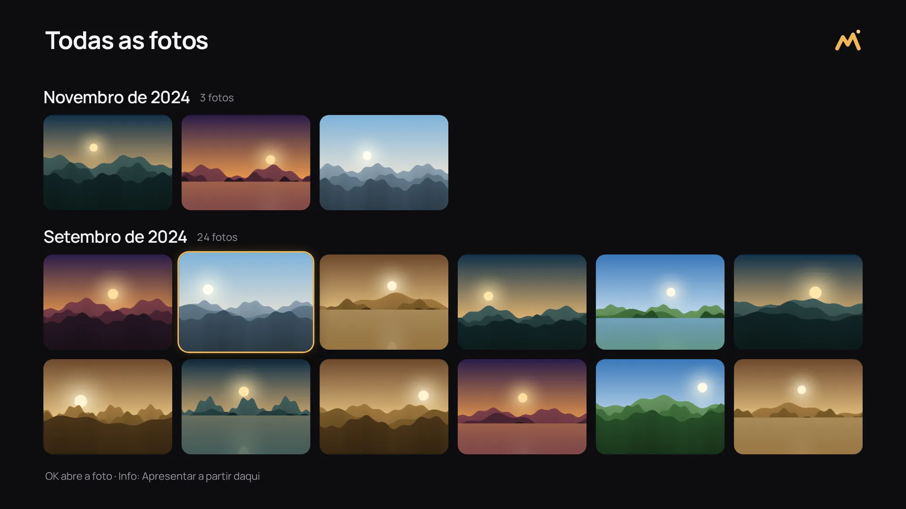
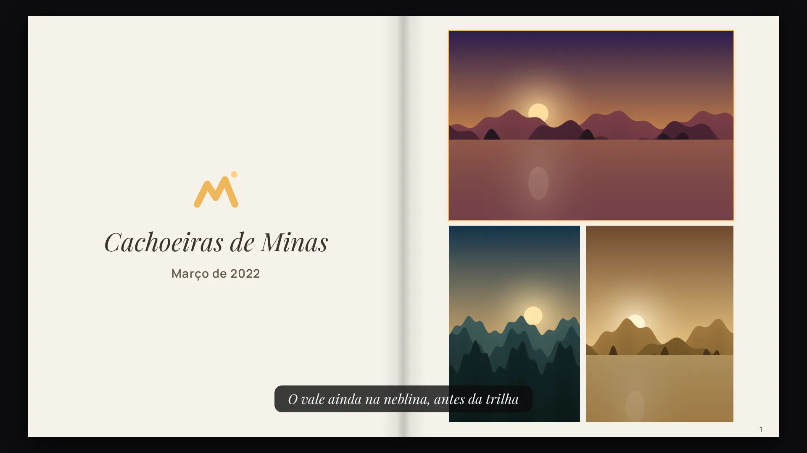
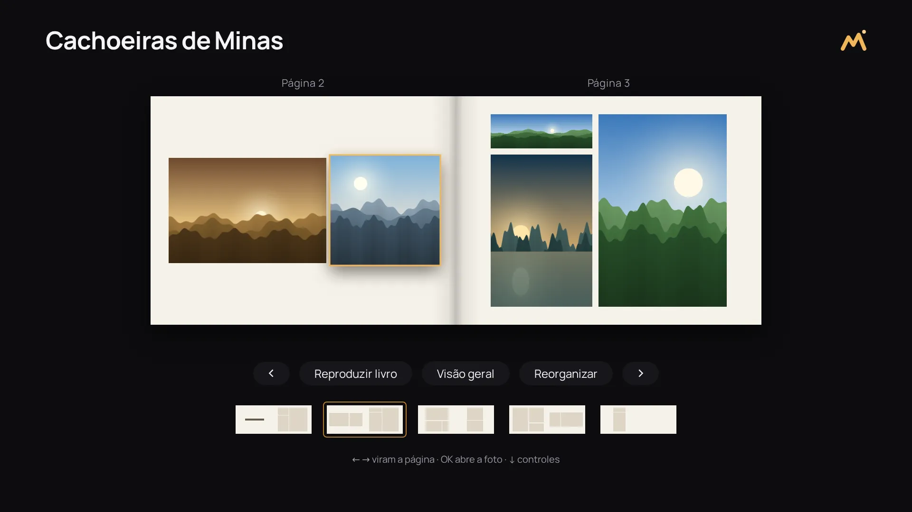
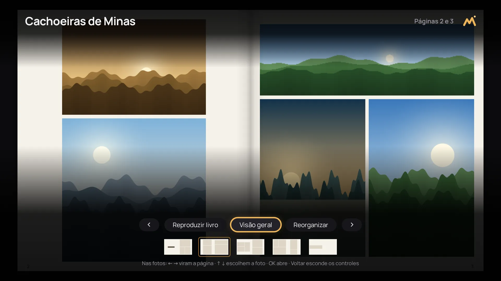
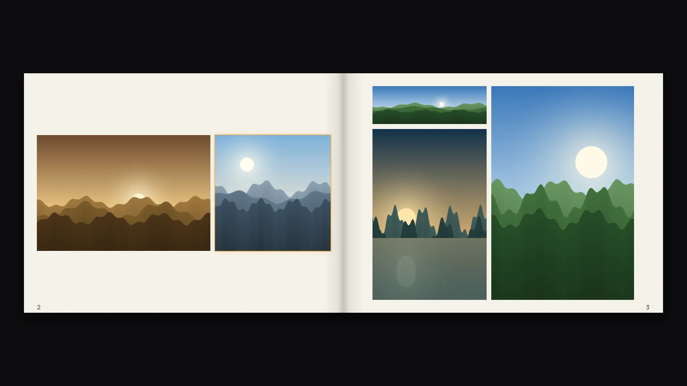

# Mirante

<p align="center">
  
</p>

A photo gallery viewer for TVs. Mirante runs in the TV's browser or as an app of the TV,
reads the photos of your [Immich](https://immich.app/) server and is driven by the remote control
alone: arrows, Enter and Back (and Info, optional).

> **Status: version 1 in progress.** The gallery works in the browser of the TV: every photo in one
> grid, albums, the timeline by year and month, the full-screen viewer, presentations of an album,
> a month, a year or the whole library, with their settings and the captions written in Immich, and
> an album or a month seen as a photo book, its pages laid out by an algorithm, and, when the proxy
> holds a second key for it, photos sent to the trash and albums created and managed. It also
> packages as an LG webOS app (`.ipk`, see [docs/webos.md](docs/webos.md)) and as a Samsung Tizen
> app (an unsigned `.wgt` you sign with your own certificates, see [docs/tizen.md](docs/tizen.md)),
> neither tried on a real TV yet.

## Scope

Version 1 shows photos and, if the owner allows it, manages them:

- every photo of the library, the most recent first, month by month; albums and the timeline of
  the library; and a full-screen photo viewer with a slideshow;
- presentations of an album, a month, a year or the whole library (at random), with the captions
  written in Immich and settings each TV keeps: the interval, the order, the transition (cut, fade,
  slide or a slow "Ken Burns" zoom), what shows over the photo, and a lighter mode for slow TVs;
- an album or a month as a photo book, in spreads of two pages with several photos on each, laid
  out from the real shapes of the photos (never cut, never stretched), different from page to page,
  played a spread at a time if wanted, and reorganized at will;
- **management**, only when the proxy in front of Immich holds a second key for the changes
  (see [Managing photos and albums](#managing-photos-and-albums)): photos sent to Immich's trash
  (never deleted for good) and back, one at a time or many at once, and albums created, renamed,
  deleted (their photos kept), filled and emptied;
- navigation with the remote control only, with the focus always visible;
- a runtime configuration file, so that the same build serves any Immich server.

Out of scope on purpose: video, people, search, upload, editing photos, favorites, archives,
sharing, deleting for good and anything else that writes to Immich but the management above, and,
for the book, editing its pages by hand, printing or exporting it.

> **Mirante is no longer read only once the key of the changes is active.** Without it (the
> default), Mirante never changes your library. With it, anyone who opens Mirante on the network of
> the proxy can send photos to Immich's trash and manage the albums, with no login or PIN; every
> deletion asks for a confirmation that says what goes and how many photos.

## Supported TVs

| TV                                 | Platform              | Browser engine |
| ---------------------------------- | --------------------- | -------------- |
| Samsung QN65Q60B (2022)            | Tizen 6.5             | Chromium ~85   |
| LG (any webOS with Chromium 68 up) | webOS 5.0 and later   | Chromium 68 up |
| Desktop browsers, for development  | Chrome, Edge, Firefox | current        |

Chromium 68 is the floor, and the build enforces it: the bundle targets ES2018 and is checked with
es-check, TypeScript only knows the ES2018 built-ins, ESLint and `make build` reject the web APIs
Chromium 68 lacks (`structuredClone`...) in Mirante's code and in the dependencies it bundles, and
Stylelint rejects CSS it lacks (`:has`, `aspect-ratio`, `gap` in flexbox, `:focus-visible`...). The
two the dependencies need anyway, `queueMicrotask` (Preact) and `Object.fromEntries` (the Immich
SDK), are polyfilled. Assets load through relative paths and there is no service worker, so the same
`dist/` works from a web server and packaged as a Tizen `.wgt`. The webOS `.ipk` gets the same app
as one classic script instead of a module, because webOS refuses module scripts from the TV's file
system (see [docs/webos.md](docs/webos.md#what-the-lg-taught-us)).

### Remote control

| Key        | Tizen | webOS | Desktop (to simulate) |
| ---------- | ----- | ----- | --------------------- |
| Arrows     | 37–40 | 37–40 | arrow keys            |
| Enter / OK | 13    | 13    | Enter                 |
| Back       | 10009 | 461   | Escape or Backspace   |
| Info       | 457   | 457   | I                     |

The focus is always visible, and every screen is reachable with these keys only; nothing needs a
mouse or a touch screen. A held arrow keeps moving; a held Enter, Back or Info acts once. Info is
optional: it opens the settings over the viewer, which Down opens too, and presents from the photo
in focus in **Todas**, which OK in the viewer does too, for remote controls without it. Tizen only sends Info to an app that registers it, which Mirante does at startup (the
`tv.inputdevice` privilege of `tizen/config.xml`). When the library can change, Up on the first row
of the photos of an album or a month reaches the bar of actions above them, and Up in the viewer
opens the actions on the photo on the screen. The name of an album is typed with the TV's own
keyboard, which opens when its field takes the focus; in that field, the keys type (Backspace and
I are no longer Back and Info there).

## Screens

| Screen   | What it shows                                             | Enter                          | Back                               |
| -------- | --------------------------------------------------------- | ------------------------------ | ---------------------------------- |
| Start    | the logo, the count of the library and five cards         | opens the one in focus         | leaves the app (TV apps)           |
| All      | every photo, the most recent first, under each month      | opens the photo in the viewer  | start                              |
| Albums   | the covers, with each album's name and number of photos   | opens the album                | start, focus where it was          |
| Album    | **Ver como livro**, then the album's photos, in its order | opens the book, or the photo   | albums, on the album that was open |
| Timeline | the years with photos, the most recent first              | opens the year's months        | start                              |
| Year     | the months with photos, in calendar order                 | opens the month's photos       | years, on the year that was open   |
| Month    | **Ver como livro**, then the photos, first to last        | opens the book, or the photo   | months, on the month that was open |
| Viewer   | one photo, full screen; ← and → for the previous and next | starts or pauses the slideshow | the grid, on the photo shown last  |
| Book     | two pages of photos, full screen; controls when asked for | opens the photo, or the button | hides the controls, or the tile    |
| Present  | the library, an album, a year, a month; or a book         | presents it, or opens the list | start                              |
| Settings | the settings of the presentations, with their values      | flips a switch                 | keeps them, start                  |

The app opens on its logo while it connects to Immich, and moves on to the start screen as soon as
the server answers. Behind the start screen lie, darkened, the photos taken on this day in past
years: up to 10, taking turns every 15 seconds with a fade, each with a discreet caption in its
lower right corner, **Há 3 anos**. Without any on this very day, the nearest day that has some, up
to 30 days before or after it in any past year (**Há 3 anos, em 4 de novembro**); this year's photos
never count. The choice stays the same all day long and changes the next day. "Today" is the day on
the TV's own clock, and a photo's date is the one Immich shows, where it was taken. Without photos
near this day, the cover of the most recent album; without one, a plain background. Under the logo, a line that says what the library
holds (**12.340 fotos · de 2019 a 2026**, counted from the months of the timeline, videos included
as Immich counts them; nothing for an empty library or when the read fails) and five cards:
**Todas**, **Álbuns**, **Linha do tempo**, **Apresentar** and **Ajustes**.

### Every photo

**Todas** shows the whole library as one grid, the most recent photo first, like the "Recents" of
a phone: each month opens with its name and how many photos it has. The months are read from
Immich one at a time, from the most recent, as the focus nears the end of what is read, so a TV
never asks for the whole library at once, and only the rows on the screen (and one around them)
are rendered. ← and → go through the photos one by one, across rows and months; ↑ and ↓ change rows.
OK opens the viewer, which goes on through the whole library in the same order, reading the next
month ahead of it; Back returns to the grid on the photo shown last. **Info** (or OK again in the
viewer) presents from the photo in focus, in the order of the screen, with the settings of the TV
(its order setting aside). When a month cannot be read, the grid says so under the photos and
tries again on the next move.

Back on the start screen, and on the connecting and error screens before it, leaves the app when
it runs as a webOS or a Tizen app (the TV returns to its launcher); in a browser it stays on the
page.

### Managing photos and albums

Only when the proxy holds the key of the changes ([docs/proxy.md](docs/proxy.md#the-changes-optional));
Mirante asks Immich at startup what that key may do, and whether Immich keeps a trash, and offers
only what both allow. Without the key, nothing changes from a read-only Mirante: no bar, no new
album, and Up on a photo says why (**Este Mirante só mostra as fotos: o proxy não tem a chave de
escrita do Immich.**); a key without some permission, or an Immich without its trash, leaves those
actions out, with the reason beside the others.

- **Above the photos of an album or a month**, a bar: **Selecionar**, and, in an album,
  **Renomear álbum** and **Apagar álbum**. Up on the first row reaches it; Down goes back.
  **Selecionar** marks photos with OK (an amber check), and the bar then offers **Adicionar ao
  álbum**, **Tirar do álbum** (in an album), **Apagar** and **Concluir**, with how many are marked;
  Back reaches the bar from anywhere in the grid while it selects.
- **In the viewer**, Up opens the same actions for the photo on the screen. After a deletion or a
  removal, the next photo takes its place; Back returns to the grid on it.
- **Apagar** sends the photos to Immich's trash after a confirmation (**Apagar 3 fotos?**, with
  Cancelar in focus); **Desfazer**, first in the bar or the menu for 30 seconds, brings them back.
  Immich empties its trash after the days of its settings (30 by default). **Apagar álbum** asks
  too, and says the photos stay in the library.
- **Adicionar ao álbum** opens a list: **Novo álbum** first, then the albums, the most recent first
  (only seven show at a time, however many there are). **Novo álbum** suggests a name, the month of
  the photos (**Março de 2024**) or else the day, created with one more OK; Up goes to the field to
  type another. **Álbuns** starts with a **Novo álbum** tile too, for an empty album.
- Every change shows at once, before Immich answers, and a line at the bottom says what happened.
  If Immich refuses it, the screen goes back to how it was and the line says why (**Não foi
  possível apagar 3 fotos. Nada mudou: o Immich não respondeu.**). Nothing waits behind a loading
  screen.

### Presentations

**Apresentar** offers the whole library, which starts at once, or an album, a year or a month,
chosen on the screens of the gallery (**Apresentar um álbum**...). A presentation plays as soon as
its photos arrive; Back returns to where it was chosen. The whole library comes from Immich as
random draws of 200 photos, a new draw for each round while it loops, so a TV never holds the list
of every photo. The viewer opened from a grid plays the same way on Enter, in the order of the grid.

How a presentation runs comes from the settings: each photo stays on the screen for the interval;
the order is by date (oldest or newest first) or random (each photo once before any comes again,
never the same photo twice in a row across rounds), and the library is always random; the
transition is a cut, a fade, a slide, or a slow zoom ("Ken Burns") that drifts each photo the way
its id decides; the date, the counter and the keys show at each change and hide after a few
seconds; the presentation loops or stops on the last photo; and **Reduzir efeitos** leaves a plain
fade without zoom, for slow TVs. Only `opacity` and `transform` animate, and at most three photos
are decoded at once (the photo after the next one is only downloaded ahead).

The **caption** of a photo is its description in Immich (written in the info panel of the photo),
shown under the photo in an italic serif. It is read for the photo on the screen and the next one only,
with a small cache; a photo without one shows nothing, and nothing on the screen moves.

### The book

**Ver como livro**, the first tile of an album or a month (or **Livro de um álbum** and **Livro de
um mês** on **Apresentar**), opens its photos as a photo book that fills the screen: two facing
pages of white paper, the fold shaded between them, the number of each page small in its outer
lower corner, as in a printed book, and, if wanted, a cover with the name of the album and the
period of its photos. Only the TVs' safe area is left around the paper (3.5% of each edge; the
margins of the pages keep the photos inside the 5% of the other screens). The pages are 8:9, so a
spread is 16:9, the shape of the TV; **Formato do livro** in the settings brings back the classic
pages of 4:3, the spread as wide as the screen with a band above and below.

← and → turn the page (a short slide and a crossfade), from any photo; ↑ and ↓ go to the photo
above or below, a thin amber ring on the one in focus. ↓ from the last photo of the spread, or
Info, shows the controls over the book for a few seconds (the time of **Esconder a interface
após**, counted from the last key): at the top the name of the album, the pages on the screen and
the mark; at the bottom a bar of buttons (‹, **Reproduzir livro**, **Visão geral**,
**Reorganizar**, ›), a strip of the spreads in miniature, the one on the screen marked, and the
keys. Back hides them, and, once hidden, leaves the book. OK on a photo opens it full screen, and
Back returns to the spread of the photo shown last; OK on a spread of the strip, or of the **Visão
geral** (every spread at once), opens it. **Reproduzir livro** shows the pages alone, with a thin
amber line filling up at the bottom, and turns a spread every few seconds (10 by default), looping
or not like the presentations; any arrow or OK pauses it and shows the controls.

Nothing is laid out from a fixed list of templates. How many photos each page takes (one, two side
by side or one above the other, three, four, five, six or more) follows the shapes and the number
of the photos and the rhythm of the book: in each spread a page breathes with few photos and the
other is full, two portraits stand side by side, a panorama counts double. Where they go is an
optimization, page by page: every way to cut the page across and down, again and again (a
guillotine), with the sizes of the cuts drawn from the shapes of the photos, is scored, and the one
that fills the page best wins, every photo whole in its frame, the gap between them constant (1.5%
of the width of the page), a margin of 4% of the width of the page around them, no photo too small,
and never the same arrangement on two pages in a row. The shape of the page is a parameter of the
layout, so the same photos fill a full screen page and a classic one each in its own way. A seed makes the same book every time; **Reorganizar** draws a new one, which the TV
keeps for that album or month (`localStorage`, `mirante.books`). The pages are laid out as they are
first shown, a few at a time, so an album of thousands of photos opens at once. A photo whose
shorter side takes under 30% of the height of its page loads Immich's thumbnail, a larger one its
preview, never the original; the next spread is loaded ahead and at most two are kept decoded. The
caption of the photo in focus shows over the bottom of the book, in the italic serif, when
**Mostrar a legenda** is on.

### Settings

**Ajustes**, from the start screen, or Info (or Down) over the viewer, lists the settings with their
values, grouped under **Apresentação**, **Livro** and **Geral**: ↑ and ↓ choose a row (the list
moves with them when it is taller than the screen, and a thin bar beside it shows where you are), ← and → change its value, OK flips a switch, and a sentence beside the
list says what the value does. **Restaurar padrões** goes back to the defaults (those of
`config.json`, else the app's). Back keeps the settings on the TV (its `localStorage`, under
`mirante.presentation`, with the version of their shape: settings an older or newer version wrote,
or anything unreadable, are dropped for the defaults) and they apply at once; the order applies to
the next presentation. Five settings shape the book: **Densidade do livro** (leve, normal or densa:
fewer or more photos a page, never a fixed number), **Formato do livro** (**Tela cheia (16:9)**,
the default, or **Clássico (4:3)**), **Mostrar a capa do livro**, **Mostrar os números das
páginas** and **Tempo de cada página dupla**.

Loading, empty and error states are explained in Portuguese; on an error the **Tentar novamente**
button already has the focus.

For the TVs' small memory, the grids only render the rows on the screen (and one more, to load its
thumbnails ahead) and use Immich's thumbnails, the viewer uses its previews, never the original
files, and keeps at most three photos decoded. Every screen stays inside the TVs' safe area
(overscan).

## Look

Graphite with one soft amber accent, and one modern sans-serif for the whole interface (Manrope,
shipped with the app); an italic serif only for the captions of the photos and the title on the
cover of a book. The paper of the book stays a neutral, warm white, whatever the palette. The icon is a rounded
graphite square with an amber mark: two rounded peaks that make an M, and the sun just above the
right one, the view from a _mirante_. Cards have round corners on two levels of graphite, the focus
is an amber ring that grows a little, screens fade in, and the viewer crossfades between photos.
Captured by `make screenshots` at 1920x1080 (the settings and the book at 1280x720 too), against a
fake library:

| Start screen                                     | Albums                                     |
| ------------------------------------------------ | ------------------------------------------ |
|  |  |

| Every photo                                    | Viewer, with a caption                   |
| ---------------------------------------------- | ---------------------------------------- |
|  |  |

| A book, full screen: its cover and first page      | Two pages laid out differently                |
| -------------------------------------------------- | --------------------------------------------- |
|  |  |

| The controls over the book, when asked for                 | A classic book (4:3 pages)                               |
| ---------------------------------------------------------- | -------------------------------------------------------- |
|  |  |

Every screen: [opening](docs/screenshots/01-abertura.webp), [start](docs/screenshots/02-inicio.webp),
[albums](docs/screenshots/03-albuns.webp), [album](docs/screenshots/04-album.webp),
[photo](docs/screenshots/05-foto.webp), [slideshow](docs/screenshots/06-apresentacao.webp),
[years](docs/screenshots/07-linha-do-tempo.webp), [months](docs/screenshots/08-meses.webp),
[empty album](docs/screenshots/09-album-vazio.webp), [loading](docs/screenshots/10-carregando.webp),
[error](docs/screenshots/11-erro.webp), [presentations](docs/screenshots/12-apresentar.webp),
[settings](docs/screenshots/13-ajustes.webp),
[settings over a photo](docs/screenshots/14-ajustes-na-foto.webp),
[the settings scrolled to their end](docs/screenshots/19-ajustes-fim.webp) (and
[at 1280x720](docs/screenshots/20-ajustes-fim-720p.webp)),
[every photo](docs/screenshots/15-todas.webp), [a book](docs/screenshots/16-livro-capa.webp),
[its pages](docs/screenshots/17-livro.webp), [its controls](docs/screenshots/21-livro-controles.webp),
[its overview](docs/screenshots/18-livro-visao-geral.webp),
[a classic book](docs/screenshots/22-livro-classico.webp) and
[its controls](docs/screenshots/23-livro-classico-controles.webp), and both books on a TV of
1280x720 ([full screen](docs/screenshots/24-livro-720.webp),
[its controls](docs/screenshots/25-livro-controles-720.webp),
[classic](docs/screenshots/26-livro-classico-720.webp),
[its controls](docs/screenshots/27-livro-classico-controles-720.webp)). The icon was chosen over two
alternatives, compared in [docs/screenshots/icone-alternativas.webp](docs/screenshots/icone-alternativas.webp).

## Configuration

Mirante reads `config.json` from the folder of its `index.html` when it starts:

```json
{
  "immichUrl": "",
  "presentation": {
    "intervalSeconds": 8,
    "order": "oldest-first",
    "transition": "fade"
  }
}
```

- `immichUrl`: where the Immich API is, without `/api` at the end. Leave it empty (or `/`) when
  Mirante is served at the same address as Immich (see [Reaching Immich](#reaching-immich)), use a
  path such as `/immich` when the proxy serves Immich under one, or a full address such as
  `http://192.168.0.10:2283`.
- `apiKey` (optional): an Immich API key (**Account Settings → API Keys** in Immich). Leave it out
  when the proxy adds the key, which is what makes the images load. If you set one, create it only
  for Mirante, with read permissions only (`album.read`, `asset.read`, `asset.view`).
- `presentation` (optional): the defaults of the settings of the presentations, for every TV that
  has not changed them (each TV keeps its own changes). Any field may be left out:

  | Field                  | Values                                         | Default          |
  | ---------------------- | ---------------------------------------------- | ---------------- |
  | `intervalSeconds`      | 3 to 60 (rounded to whole seconds)             | 8                |
  | `order`                | `"oldest-first"`, `"newest-first"`, `"random"` | `"oldest-first"` |
  | `transition`           | `"cut"`, `"fade"`, `"slide"`, `"ken-burns"`    | `"fade"`         |
  | `zoom`                 | `"gentle"`, `"normal"` (the slow zoom)         | `"gentle"`       |
  | `showDate`             | `true`, `false`                                | `true`           |
  | `showCaption`          | `true`, `false`                                | `true`           |
  | `showCounter`          | `true`, `false`                                | `true`           |
  | `loop`                 | `true`, `false`                                | `true`           |
  | `hideInterfaceSeconds` | 3 to 20                                        | 4                |
  | `reduceEffects`        | `true`, `false`                                | `false`          |
  | `bookDensity`          | `"light"`, `"normal"`, `"dense"`               | `"normal"`       |
  | `bookFormat`           | `"wide"` (full screen, 16:9), `"classic"`      | `"wide"`         |
  | `showBookCover`        | `true`, `false`                                | `true`           |
  | `showPageNumbers`      | `true`, `false`                                | `true`           |
  | `bookSpreadSeconds`    | 3 to 60, each spread while a book plays        | 10               |

  A value of the wrong type, an unknown option or a number out of its limits is reported on the
  screen (**Ajustes da apresentação inválidos**), like any other mistake in the file.

- `slideshowSeconds` (optional, older): the interval before the `presentation` block existed, still
  read, from 3 to 3600 seconds; it sets the default interval, brought within 3 to 60, when
  `presentation.intervalSeconds` is absent.

Copy [`public/config.example.json`](public/config.example.json) to `public/config.json` for
development, or to `config.json` next to `index.html` in `dist/` for an installation. `config.json`
is ignored by git at any level: **never commit it**. The file is read again on every start (and on
**Tentar novamente**), so fixing it needs no rebuild.

### Reaching Immich

The TV must reach the Immich server (same network, or Tailscale). Immich only sends CORS headers in
its development mode, so a browser blocks Mirante's requests when Mirante comes from another origin
than Immich. Mirante is therefore served **at the same address as Immich**, behind a reverse proxy
(Caddy, nginx...) that sends `/api` to Immich and everything else to `dist/`, with `immichUrl` left
empty.

The photos load as plain images (``) from that same address
(`/api/assets/{id}/thumbnail?size=thumbnail` in the grids, `size=preview` in the viewer), never as
blobs downloaded by the app and never with the key in the address. An image request carries no
`x-api-key` header, so **the proxy adds the key** to the requests it sends to `/api`, and `apiKey`
stays out of `config.json`. With a key in `config.json` and no proxy adding it, the albums and the
timeline load but the images do not. Mirante reports a request the browser blocked as "O Immich não
respondeu", and an Immich that asked for a key nobody sent as "O Immich pediu uma chave de API". The
proxy itself is not part of this repository: [docs/proxy.md](docs/proxy.md) lists exactly the
routes and methods Mirante calls (the reads of the gallery, the random draw of the library and the
detail of a photo for its caption; and, to manage the library, the seven changes with their exact
bodies), what must stay forbidden (originals, videos, deletions for good, anything else that
writes), a Caddyfile that allows only those, and how to create and activate the second key, the one
of the changes, which lives only on the proxy.

## Running it

You need Node.js 24 and npm.

```sh
make setup    # locked dependencies and the git hooks
make dev      # http://localhost:5173, with public/config.json
make build    # dist/: the app the TVs load, and build/webos-dist/ for webOS, checked against Chromium 68
```

Serve `dist/` (plus its `config.json`) behind the proxy in front of Immich (see
[Reaching Immich](#reaching-immich)) and open that address in the TV's browser.

### As an LG webOS app

```sh
cp webos/config.example.json webos/config.json   # or: export MIRANTE_IMMICH_URL=http://...
make package-webos   # build/webos/com.mathmed.mirante_<version>_all.ipk
make test-webos      # runs the package from file:// in a headless Chromium made to look like the LG
```

The packaged app loads from the TV's file system, so its `config.json` names the **full address**
of the proxy (`immichUrl` such as `http://192.168.0.10:8085`), never a key, and the proxy must
answer CORS. [docs/webos.md](docs/webos.md) explains the package, Developer Mode on the TV (which
expires and must be extended from time to time), and installing, opening and debugging the app
with LG's webOS CLI (`ares-setup-device`, `ares-install`, `ares-launch`, `ares-inspect`).

### As a Samsung Tizen app

```sh
cp tizen/config.example.json tizen/config.json   # or: export MIRANTE_IMMICH_URL=http://...
make package-tizen   # build/tizen/Mirante.wgt, unsigned, and the folder build/tizen/widget/
make test-tizen      # runs the package from file:// in a headless Chromium
```

The same rules hold: the **full address** of the proxy, never a key, and CORS. The `.wgt` is **not
signed**, and a Samsung TV only installs a package signed with an author certificate and a Samsung
distributor certificate that lists the TV's DUID. Creating them needs Tizen Studio's Certificate
Manager and a Samsung account, a manual step for each owner. [docs/tizen.md](docs/tizen.md) explains
the package, Developer Mode on the TV, the certificates (and their expiry), and signing,
installing and opening the app with the Tizen CLI (`tizen package`, `sdb connect`,
`tizen install`, `tizen run`).

## Why Preact

The TVs have little memory and old engines. Preact keeps React's component and hooks model at a
fraction of its weight (about 5 kB gzipped against about 60 kB for React 19 with `react-dom`), has no
dependency, and its output runs on engines much older than Chromium 68. The whole app, Immich SDK
and every screen included, is about 53 kB of JavaScript gzipped today, plus its four font files
(about 64 kB: three weights of Manrope and the italic of Playfair Display).

## Architecture

```
src/core/      pure logic, no DOM and no package: the startup flow, the runtime configuration, the
               photo library interface and its domain types, the focus navigation of the grids, the
               feed of every photo (its months read on demand and its grid with a heading per
               month), the count of the library, the stack of screens, the presentations: their
               settings and how they are kept, the
               engine (playlists, rounds, seeded shuffles, what loads ahead), their sources, the
               transitions and the captions; and the book: how many photos each page takes, the
               layout of a page as an optimization, its spreads, its remote control and its seeds;
               and the changes to the library: what the key allows, the actions each screen
               offers, the selection, the optimistic changes and how a refusal takes them back
src/immich/    the photo library implemented with @immich/sdk: the reads, and the changes through
               the key of the proxy (to the trash, never for good)
src/platform/  what differs between TVs and browsers: config.json, polyfills, the console, the keys
               of the remote controls (and the Info key Tizen registers), localStorage, the seeds
src/ui/        Preact components and every user-facing text (Brazilian Portuguese)
src/main.tsx   composition root: wires the adapters into the UI
test/          test support: the fake Immich server (MSW), a stub library, a fake remote control and
               throwaway git repositories
scripts/       tooling: the logo, the webOS and Tizen packaging, Quality Report, suppression ratchet,
               mutation runner, risk label check
webos/         the appinfo.json of the webOS app and the example of its config.json
tizen/         the config.xml of the Tizen app and the example of its config.json
e2e/           the end-to-end tests of the TV packages and the screenshots (Playwright), and their
               fake Immich server
```

The layers are enforced by dependency-cruiser; [`CLAUDE.md`](CLAUDE.md) has the full rules and
[`CONTRIBUTING.md`](CONTRIBUTING.md) the development workflow and the quality pipeline.

## License

[MIT](LICENSE) © 2026 Mateus Medeiros de Araujo
