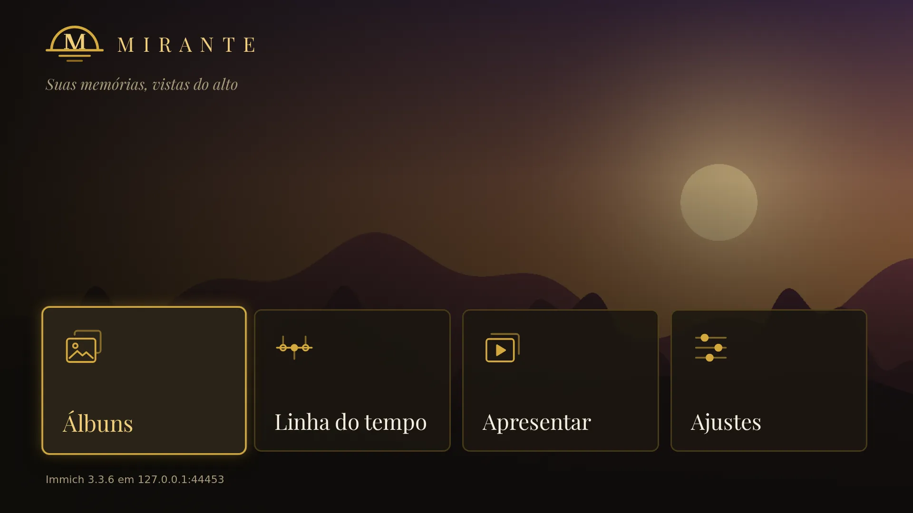
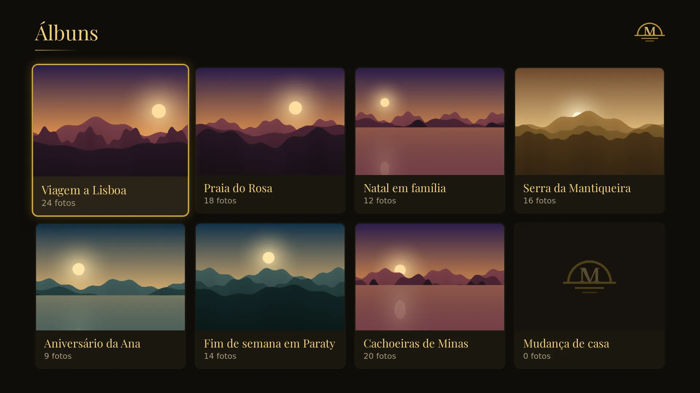
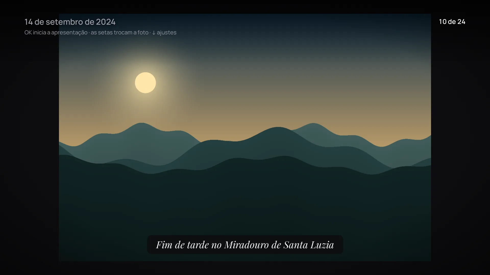
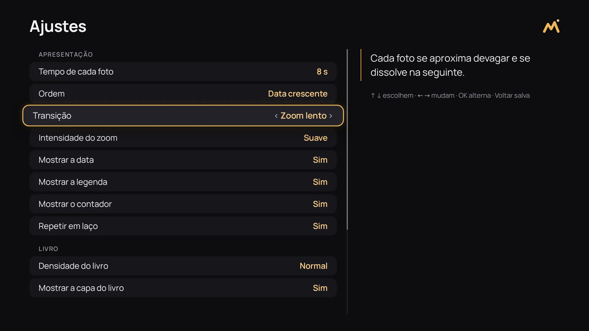

# Mirante

<p align="center">
  
</p>

A photo gallery viewer for TVs. Mirante runs in the TV's browser or as an app of the TV,
reads the photos of your [Immich](https://immich.app/) server and is driven by the remote control
alone: arrows, Enter and Back (and Info, optional).

> **Status: version 1 in progress.** The gallery works in the browser of the TV: albums, the
> timeline by year and month, the full-screen viewer, and presentations of an album, a month, a
> year or the whole library, with their settings and the captions written in Immich. It also
> packages as an LG webOS app (`.ipk`, see [docs/webos.md](docs/webos.md)) and as a Samsung Tizen
> app (an unsigned `.wgt` you sign with your own certificates, see [docs/tizen.md](docs/tizen.md)),
> neither tried on a real TV yet.

## Scope

Version 1 shows photos, read only:

- albums and the timeline of the library, and a full-screen photo viewer with a slideshow;
- presentations of an album, a month, a year or the whole library (at random), with the captions
  written in Immich and settings each TV keeps: the interval, the order, the transition (cut, fade,
  slide or a slow "Ken Burns" zoom), what shows over the photo, and a lighter mode for slow TVs;
- navigation with the remote control only, with the focus always visible;
- a runtime configuration file, so that the same build serves any Immich server.

Out of scope on purpose: video, people, search, upload, editing and anything else that writes to
Immich. Mirante never changes your library.

## Supported TVs

| TV                                 | Platform              | Browser engine |
| ---------------------------------- | --------------------- | -------------- |
| Samsung QN65Q60B (2022)            | Tizen 6.5             | Chromium ~85   |
| LG (any webOS with Chromium 68 up) | webOS 5.0 and later   | Chromium 68 up |
| Desktop browsers, for development  | Chrome, Edge, Firefox | current        |

Chromium 68 is the floor, and the build enforces it: the bundle targets ES2018 and is checked with
es-check, TypeScript only knows the ES2018 built-ins, ESLint and `make build` reject the web APIs
Chromium 68 lacks (`structuredClone`...) in Mirante's code and in the dependencies it bundles, and
Stylelint rejects CSS it lacks (`:has`, `aspect-ratio`, `gap` in flexbox, `:focus-visible`...). The
two the dependencies need anyway, `queueMicrotask` (Preact) and `Object.fromEntries` (the Immich
SDK), are polyfilled. Assets load through relative paths and there is no service worker, so the same
`dist/` works from a web server and packaged as a Tizen `.wgt`. The webOS `.ipk` gets the same app
as one classic script instead of a module, because webOS refuses module scripts from the TV's file
system (see [docs/webos.md](docs/webos.md#what-the-lg-taught-us)).

### Remote control

| Key        | Tizen | webOS | Desktop (to simulate) |
| ---------- | ----- | ----- | --------------------- |
| Arrows     | 37–40 | 37–40 | arrow keys            |
| Enter / OK | 13    | 13    | Enter                 |
| Back       | 10009 | 461   | Escape or Backspace   |
| Info       | 457   | 457   | I                     |

The focus is always visible, and every screen is reachable with these keys only; nothing needs a
mouse or a touch screen. A held arrow keeps moving; a held Enter, Back or Info acts once. Info is
optional: it opens the settings over the viewer, which Down opens too, for remote controls without
it. Tizen only sends Info to an app that registers it, which Mirante does at startup (the
`tv.inputdevice` privilege of `tizen/config.xml`).

## Screens

| Screen   | What it shows                                             | Enter                          | Back                               |
| -------- | --------------------------------------------------------- | ------------------------------ | ---------------------------------- |
| Start    | the logo and four cards, over a photo (see below)         | opens the one in focus         | leaves the app (TV apps)           |
| Albums   | the covers, with each album's name and number of photos   | opens the album                | start, focus where it was          |
| Album    | the album's photos, in the order chosen for it in Immich  | opens the photo in the viewer  | albums, on the album that was open |
| Timeline | the years with photos, the most recent first              | opens the year's months        | start                              |
| Year     | the months with photos, in calendar order                 | opens the month's photos       | years, on the year that was open   |
| Month    | the month's photos, from the first to the last            | opens the photo in the viewer  | months, on the month that was open |
| Viewer   | one photo, full screen; ← and → for the previous and next | starts or pauses the slideshow | the grid, on the photo shown last  |
| Present  | the whole library, an album, a year or a month            | presents it, or opens the list | start                              |
| Settings | the settings of the presentations, with their values      | flips a switch                 | keeps them, start                  |

The app opens on its logo while it connects to Immich, and moves on to the start screen as soon as
the server answers. Behind the start screen lies the cover of the most recent album, darkened (a
plain background when no album has a cover), under four cards: **Álbuns**, **Linha do tempo**,
**Apresentar** and **Ajustes**.

Back on the start screen, and on the connecting and error screens before it, leaves the app when
it runs as a webOS or a Tizen app (the TV returns to its launcher); in a browser it stays on the
page.

### Presentations

**Apresentar** offers the whole library, which starts at once, or an album, a year or a month,
chosen on the screens of the gallery (**Apresentar um álbum**...). A presentation plays as soon as
its photos arrive; Back returns to where it was chosen. The whole library comes from Immich as
random draws of 200 photos, a new draw for each round while it loops, so a TV never holds the list
of every photo. The viewer opened from a grid plays the same way on Enter, in the order of the grid.

How a presentation runs comes from the settings: each photo stays on the screen for the interval;
the order is by date (oldest or newest first) or random (each photo once before any comes again,
never the same photo twice in a row across rounds), and the library is always random; the
transition is a cut, a fade, a slide, or a slow zoom ("Ken Burns") that drifts each photo the way
its id decides; the date, the counter and the keys show at each change and hide after a few
seconds; the presentation loops or stops on the last photo; and **Reduzir efeitos** leaves a plain
fade without zoom, for slow TVs. Only `opacity` and `transform` animate, and at most three photos
are decoded at once (the photo after the next one is only downloaded ahead).

The **caption** of a photo is its description in Immich (written in the info panel of the photo),
shown under the photo in an italic serif. It is read for the photo on the screen and the next one only,
with a small cache; a photo without one shows nothing, and nothing on the screen moves.

### Settings

**Ajustes**, from the start screen, or Info (or Down) over the viewer, lists the settings with their
values: ↑ and ↓ choose a row, ← and → change its value, OK flips a switch, and a sentence beside the
list says what the value does. **Restaurar padrões** goes back to the defaults (those of
`config.json`, else the app's). Back keeps the settings on the TV (its `localStorage`, under
`mirante.presentation`, with the version of their shape: settings an older or newer version wrote,
or anything unreadable, are dropped for the defaults) and they apply at once; the order applies to
the next presentation.

Loading, empty and error states are explained in Portuguese; on an error the **Tentar novamente**
button already has the focus.

For the TVs' small memory, the grids only render the rows on the screen (and one more, to load its
thumbnails ahead) and use Immich's thumbnails, the viewer uses its previews, never the original
files, and keeps at most three photos decoded. Every screen stays inside the TVs' safe area
(overscan).

## Look

Graphite with one soft amber accent, and one modern sans-serif for the whole interface (Manrope,
shipped with the app); an italic serif only for the captions of the photos. The icon is a rounded
graphite square with an amber mark: two rounded peaks that make an M, and the sun just above the
right one, the view from a _mirante_. Cards have round corners on two levels of graphite, the focus
is an amber ring that grows a little, screens fade in, and the viewer crossfades between photos.
Captured by `make screenshots` at 1920x1080, against a fake library:

| Start screen                                     | Albums                                     |
| ------------------------------------------------ | ------------------------------------------ |
|  |  |

| Viewer, with a caption                   | Settings                                      |
| ---------------------------------------- | --------------------------------------------- |
|  |  |

Every screen: [opening](docs/screenshots/01-abertura.webp), [start](docs/screenshots/02-inicio.webp),
[albums](docs/screenshots/03-albuns.webp), [album](docs/screenshots/04-album.webp),
[photo](docs/screenshots/05-foto.webp), [slideshow](docs/screenshots/06-apresentacao.webp),
[years](docs/screenshots/07-linha-do-tempo.webp), [months](docs/screenshots/08-meses.webp),
[empty album](docs/screenshots/09-album-vazio.webp), [loading](docs/screenshots/10-carregando.webp),
[error](docs/screenshots/11-erro.webp), [presentations](docs/screenshots/12-apresentar.webp),
[settings](docs/screenshots/13-ajustes.webp) and
[settings over a photo](docs/screenshots/14-ajustes-na-foto.webp). The icon was chosen over two
alternatives, compared in [docs/screenshots/icone-alternativas.webp](docs/screenshots/icone-alternativas.webp).

## Configuration

Mirante reads `config.json` from the folder of its `index.html` when it starts:

```json
{
  "immichUrl": "",
  "presentation": {
    "intervalSeconds": 8,
    "order": "oldest-first",
    "transition": "fade"
  }
}
```

- `immichUrl`: where the Immich API is, without `/api` at the end. Leave it empty (or `/`) when
  Mirante is served at the same address as Immich (see [Reaching Immich](#reaching-immich)), use a
  path such as `/immich` when the proxy serves Immich under one, or a full address such as
  `http://192.168.0.10:2283`.
- `apiKey` (optional): an Immich API key (**Account Settings → API Keys** in Immich). Leave it out
  when the proxy adds the key, which is what makes the images load. If you set one, create it only
  for Mirante, with read permissions only (`album.read`, `asset.read`, `asset.view`).
- `presentation` (optional): the defaults of the settings of the presentations, for every TV that
  has not changed them (each TV keeps its own changes). Any field may be left out:

  | Field                  | Values                                         | Default          |
  | ---------------------- | ---------------------------------------------- | ---------------- |
  | `intervalSeconds`      | 3 to 60 (rounded to whole seconds)             | 8                |
  | `order`                | `"oldest-first"`, `"newest-first"`, `"random"` | `"oldest-first"` |
  | `transition`           | `"cut"`, `"fade"`, `"slide"`, `"ken-burns"`    | `"fade"`         |
  | `zoom`                 | `"gentle"`, `"normal"` (the slow zoom)         | `"gentle"`       |
  | `showDate`             | `true`, `false`                                | `true`           |
  | `showCaption`          | `true`, `false`                                | `true`           |
  | `showCounter`          | `true`, `false`                                | `true`           |
  | `loop`                 | `true`, `false`                                | `true`           |
  | `hideInterfaceSeconds` | 3 to 20                                        | 4                |
  | `reduceEffects`        | `true`, `false`                                | `false`          |

  A value of the wrong type, an unknown option or a number out of its limits is reported on the
  screen (**Ajustes da apresentação inválidos**), like any other mistake in the file.

- `slideshowSeconds` (optional, older): the interval before the `presentation` block existed, still
  read, from 3 to 3600 seconds; it sets the default interval, brought within 3 to 60, when
  `presentation.intervalSeconds` is absent.

Copy [`public/config.example.json`](public/config.example.json) to `public/config.json` for
development, or to `config.json` next to `index.html` in `dist/` for an installation. `config.json`
is ignored by git at any level: **never commit it**. The file is read again on every start (and on
**Tentar novamente**), so fixing it needs no rebuild.

### Reaching Immich

The TV must reach the Immich server (same network, or Tailscale). Immich only sends CORS headers in
its development mode, so a browser blocks Mirante's requests when Mirante comes from another origin
than Immich. Mirante is therefore served **at the same address as Immich**, behind a reverse proxy
(Caddy, nginx...) that sends `/api` to Immich and everything else to `dist/`, with `immichUrl` left
empty.

The photos load as plain images (``) from that same address
(`/api/assets/{id}/thumbnail?size=thumbnail` in the grids, `size=preview` in the viewer), never as
blobs downloaded by the app and never with the key in the address. An image request carries no
`x-api-key` header, so **the proxy adds the key** to the requests it sends to `/api`, and `apiKey`
stays out of `config.json`. With a key in `config.json` and no proxy adding it, the albums and the
timeline load but the images do not. Mirante reports a request the browser blocked as "O Immich não
respondeu", and an Immich that asked for a key nobody sent as "O Immich pediu uma chave de API". The
proxy itself is not part of this repository: [docs/proxy.md](docs/proxy.md) lists exactly the
routes and methods Mirante calls (the reads of the gallery, the random draw of the library and the
detail of a photo for its caption), what must stay forbidden (originals, videos, anything that
writes) and a Caddyfile that allows only those.

## Running it

You need Node.js 24 and npm.

```sh
make setup    # locked dependencies and the git hooks
make dev      # http://localhost:5173, with public/config.json
make build    # dist/: the app the TVs load, and build/webos-dist/ for webOS, checked against Chromium 68
```

Serve `dist/` (plus its `config.json`) behind the proxy in front of Immich (see
[Reaching Immich](#reaching-immich)) and open that address in the TV's browser.

### As an LG webOS app

```sh
cp webos/config.example.json webos/config.json   # or: export MIRANTE_IMMICH_URL=http://...
make package-webos   # build/webos/com.mathmed.mirante_<version>_all.ipk
make test-webos      # runs the package from file:// in a headless Chromium made to look like the LG
```

The packaged app loads from the TV's file system, so its `config.json` names the **full address**
of the proxy (`immichUrl` such as `http://192.168.0.10:8085`), never a key, and the proxy must
answer CORS. [docs/webos.md](docs/webos.md) explains the package, Developer Mode on the TV (which
expires and must be extended from time to time), and installing, opening and debugging the app
with LG's webOS CLI (`ares-setup-device`, `ares-install`, `ares-launch`, `ares-inspect`).

### As a Samsung Tizen app

```sh
cp tizen/config.example.json tizen/config.json   # or: export MIRANTE_IMMICH_URL=http://...
make package-tizen   # build/tizen/Mirante.wgt, unsigned, and the folder build/tizen/widget/
make test-tizen      # runs the package from file:// in a headless Chromium
```

The same rules hold: the **full address** of the proxy, never a key, and CORS. The `.wgt` is **not
signed**, and a Samsung TV only installs a package signed with an author certificate and a Samsung
distributor certificate that lists the TV's DUID. Creating them needs Tizen Studio's Certificate
Manager and a Samsung account, a manual step for each owner. [docs/tizen.md](docs/tizen.md) explains
the package, Developer Mode on the TV, the certificates (and their expiry), and signing,
installing and opening the app with the Tizen CLI (`tizen package`, `sdb connect`,
`tizen install`, `tizen run`).

## Why Preact

The TVs have little memory and old engines. Preact keeps React's component and hooks model at a
fraction of its weight (about 5 kB gzipped against about 60 kB for React 19 with `react-dom`), has no
dependency, and its output runs on engines much older than Chromium 68. The whole app, Immich SDK
and every screen included, is about 30 kB of JavaScript gzipped today, plus its four font files
(about 64 kB: three weights of Manrope and the italic of Playfair Display).

## Architecture

```
src/core/      pure logic, no DOM and no package: the startup flow, the runtime configuration, the
               photo library interface and its domain types, the focus navigation of the grids, the
               stack of screens, and the presentations: their settings and how they are kept, the
               engine (playlists, rounds, seeded shuffles, what loads ahead), their sources, the
               transitions and the captions
src/immich/    the photo library implemented with @immich/sdk, read only
src/platform/  what differs between TVs and browsers: config.json, polyfills, the console, the keys
               of the remote controls (and the Info key Tizen registers), localStorage, the seeds
src/ui/        Preact components and every user-facing text (Brazilian Portuguese)
src/main.tsx   composition root: wires the adapters into the UI
test/          test support: the fake Immich server (MSW), a stub library, a fake remote control and
               throwaway git repositories
scripts/       tooling: the logo, the webOS and Tizen packaging, Quality Report, suppression ratchet,
               mutation runner, risk label check
webos/         the appinfo.json of the webOS app and the example of its config.json
tizen/         the config.xml of the Tizen app and the example of its config.json
e2e/           the end-to-end tests of the TV packages and the screenshots (Playwright), and their
               fake Immich server
```

The layers are enforced by dependency-cruiser; [`CLAUDE.md`](CLAUDE.md) has the full rules and
[`CONTRIBUTING.md`](CONTRIBUTING.md) the development workflow and the quality pipeline.

## License

[MIT](LICENSE) © 2026 Mateus Medeiros de Araujo
